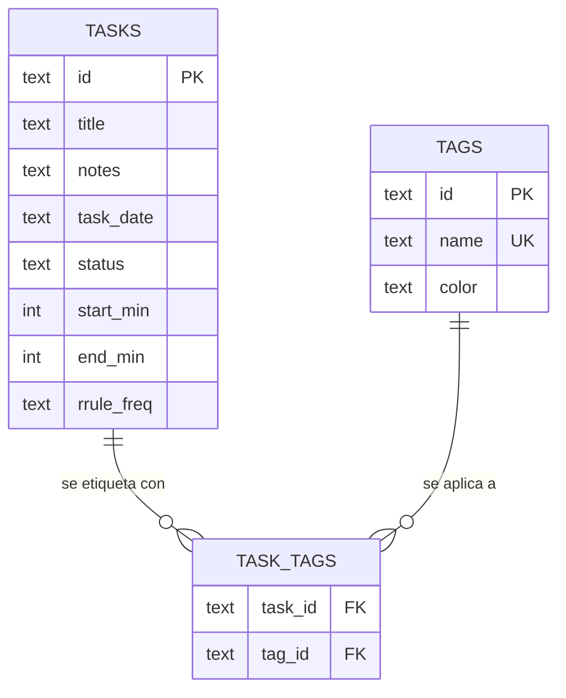

# Plan de proyecto — Aplicación de escritorio de tareas diarias

> **Nombre en clave:** `TaskDiary`
> **Documento:** plan-tasks-app.md
> **Versión:** 2.0
> **Fecha:** 2026-10-08
> **Cambio respecto a v1.0:** Tauri + Rust → **Electron + Node.js**

---

## 1. Objetivo

Construir una **aplicación de escritorio offline-first** para registrar y consultar las tareas que realizo día a día, con el foco en **ver de un vistazo qué he hecho hoy** y poder **retroceder en el tiempo** para revisar jornadas pasadas.

**Principio rector:** abrir la app y, en menos de 3 segundos, saber qué he hecho hoy, qué me queda pendiente y cómo va la semana.

### 1.1 Problema que resuelve

| Situación habitual | Solución |
| --- | --- |
| Anoto tareas en notas sueltas o en papel y las pierdo | Registro centralizado y persistente |
| No recuerdo qué hice los últimos días | Timeline consultable por fecha |
| Las listas de tareas no transmiten sensación de progreso | Heatmap de actividad y estadísticas |
| Las herramientas cloud exigen cuenta y conexión | 100 % local, sin cuenta ni telemetría |

### 1.2 Perfil de usuario

**Un único usuario: el propio desarrollador.** Esto elimina de raíz la complejidad de autenticación, roles, multi-tenancy y sincronización, que es donde se va el 80 % del esfuerzo en este tipo de aplicaciones.

---

## 2. Alcance

### 2.1 MVP — v1.0

- [ ] Crear tarea con título, notas, fecha y hora de inicio/fin
- [ ] **Vista Día** (por defecto): tareas ordenadas cronológicamente
- [ ] Estados: pendiente → en curso → completada
- [ ] Una sola tarea "en curso" a la vez (bloqueo de foco)
- [ ] Navegación por fechas: hoy / anterior / siguiente / ir a fecha
- [ ] Vista Semana (7 columnas) y Vista Mes (calendario con carga por día)
- [ ] **Heatmap de actividad** de las últimas ~26 semanas
- [ ] Etiquetas libres (`#proyecto`, `#rutina`) y filtro por etiqueta
- [ ] Búsqueda de texto en título y notas
- [ ] Tareas recurrentes (diaria, semanal, días concretos)
- [ ] Duración estimada vs. real y tiempo total invertido por día
- [ ] Exportar a Markdown/JSON e importar desde JSON/CSV
- [ ] Atajos de teclado completos y paleta de comandos (`Ctrl+K`)
- [ ] Tema claro/oscuro siguiendo el sistema
- [ ] Persistencia local en SQLite
- [ ] Instalar, actualizar y desinstalar correctamente en Windows, macOS y Linux

### 2.2 Fuera de alcance en v1

Sincronización en la nube · multiusuario · colaboración en tiempo real · versión móvil · integraciones con calendarios externos (Google Calendar, Outlook) · extensiones de terceros · CLI.

### 2.3 Backlog futuro (v1.1 – v2.0)

Interfaz web complementaria · exportación a Obsidian/Notion · plantillas de tarea · revisión semanal guiada · objetivos trimestrales · widget de escritorio · atajo de creación rápida del día · acceso desde la bandeja del sistema.

---

## 3. Requisitos funcionales

| ID | Requisito | Prioridad |
| --- | --- | --- |
| RF-01 | Crear tarea con título obligatorio, notas opcionales, fecha, hora inicio/fin y estimación | Must |
| RF-02 | Listar las tareas de una fecha en orden cronológico | Must |
| RF-03 | Cambiar estado: pendiente → en curso → completada | Must |
| RF-04 | Editar y eliminar tarea (con confirmación) | Must |
| RF-05 | Navegar entre fechas y volver a "hoy" | Must |
| RF-06 | Filtrar por etiqueta y por estado | Must |
| RF-07 | Buscar texto en título y notas | Must |
| RF-08 | Visualizar heatmap de actividad | Should |
| RF-09 | Estadísticas: completadas/día, tiempo total, racha | Should |
| RF-10 | Crear tareas recurrentes con regla | Should |
| RF-11 | Exportar/importar Markdown, JSON y CSV | Should |
| RF-12 | Atajos de teclado y paleta de comandos | Should |
| RF-13 | Recordatorios nativos para tareas con hora | Could |
| RF-14 | Deshacer la última acción (Undo) | Could |

### 3.1 Casos de uso principales

1. **UC-1 — Empezar el día:** abro la app → veo las tareas de hoy ordenadas por hora → `Ctrl+N` → creo la primera tarea en 3 segundos.
2. **UC-2 — Registrar trabajo:** al terminar algo, `Ctrl+Enter` marca completada y la app cronometra el tiempo real.
3. **UC-3 — Revisar el pasado:** navego a ayer o pincho en el heatmap → timeline de ese día con todo lo hecho.
4. **UC-4 — Cerrar la semana:** vista Semana → compruebo el balance estimaciones vs. real y la racha.

---

## 4. Requisitos no funcionales

> Objetivo realista para una app Electron bien configurada. Electron paga un coste fijo en tamaño y memoria que conviene conocer y acotar, no ignorar.

| ID | Requisito | Objetivo |
| --- | --- | --- |
| RNF-01 | Arranque en frío hasta ventana visible | < 3 s (con ventana oculta hasta `ready-to-show`) |
| RNF-02 | Crear una tarea (con atajo) | < 120 ms |
| RNF-03 | Cambio de vista o de día | < 100 ms, sin parpadeo |
| RNF-04 | Tamaño del instalador | < 100 MB comprimido |
| RNF-05 | Consumo de RAM en reposo | < 250 MB |
| RNF-06 | La app funciona 100 % offline | Obligatorio |
| RNF-07 | Los datos viven en el directorio de datos del SO, nunca en el registro de Windows | Obligatorio |
| RNF-08 | Portabilidad: exportar todo el histórico a un único archivo | Obligatorio |
| RNF-09 | Compatibilidad Windows 10/11, macOS 12+ y Linux (AppImage/deb) | Obligatorio |
| RNF-10 | Cero telemetría, cero servicios cloud | Obligatorio |
| RNF-11 | `contextIsolation: true`, `nodeIntegration: false`, `sandbox: true` en todas las ventanas | Obligatorio |
| RNF-12 | El renderer no tiene acceso directo a Node ni al sistema de archivos | Obligatorio |

---

## 5. Decisiones técnicas

### 5.1 Electron frente a Tauri (revisado)

| Criterio | Electron | Tauri |
| --- | --- | --- |
| Tamaño del instalador | ~90–150 MB | ~5–15 MB |
| RAM en reposo | ~150–300 MB | ~40–90 MB |
| Arranque | ~2–4 s | < 1,5 s |
| Lenguaje del backend | Node.js (TypeScript) | Rust |
| Curva de aprendizaje | Baja: un solo lenguaje | Media: Rust + TS |
| Reutilización de skills | Total (el código de la UI es el mismo para web y escritorio) | Parcial |
| Módulos nativos | `better-sqlite3` requiere recompilar por versión de Electron | SQLite ya enlazado |
| Ecosistema de plugins | Muy grande y maduro | Menor, en crecimiento |
| Firma de binarios | Bien soportada (`electron-builder`) | Bien soportada |

**Decisión: Electron + TypeScript.**

Motivos: un único lenguaje de extremo a extremo, sin compilación nativa obligatoria más allá de SQLite, y un ecosistema de empaquetado y actualizaciones automático muy maduro. El coste asumido son el tamaño y el consumo, mitigados en §14.

> Nota: `better-sqlite3` es un módulo nativo y hay que recompilarlo para la versión de Electron usada. Es un paso automatizado con `electron-builder install-app-deps`; queda fuera del camino crítico porque puede sustituirse por `sql.js` (WebAssembly, sin compilación) si se quiere evitar.

### 5.2 Stack completo

| Capa | Tecnología | Versión aprox. | Motivo |
| --- | --- | --- | --- |
| Shell | **Electron** | 32.x | Runtime multiplataforma con APIs nativas |
| Build de desarrollo | **electron-vite** | 2.x | Vite integrado para main, preload y renderer |
| Empaquetado | **electron-builder** | 25.x | NSIS/MSI, dmg, AppImage/deb, firma y updates |
| Empaquetado | **electron-updater** | 6.x | Actualizaciones automáticas desde GitHub Releases |
| Lenguaje | **TypeScript** | 5.x | Un solo lenguaje en todos los procesos |
| Framework UI | **React** | 18.x | Ecosistema maduro y curva de aprendizaje baja |
| Bundler UI | **Vite** | 5.x | Arranque instantáneo en desarrollo |
| Enrutado UI | **React Router** | 6.x | Rutas por fecha y vista |
| Componentes UI | **shadcn/ui** + Radix | — | Sin dependencia de estilos, personalizable |
| Estilos | **Tailwind CSS** | 3.x | Consistencia y poco código |
| Estado global | **Zustand** | 4.x | Mínimo boilerplate, ideal para un store local |
| Búsqueda en cliente | **Fuse.js** | 7.x | Búsqueda difusa en títulos y notas |
| Datos | **SQLite** (`better-sqlite3`) | — | Síncrono, rápido, sin servidor |
| Validación | **Zod** | 3.x | Validar la entrada en el borde IPC |
| Fecha/hora | **date-fns** | 3.x | Formateo y zonas horarias |
| Virtualización | **@tanstack/react-virtual** | 3.x | Listas largas sin caída de frames |
| Tests | **Vitest** + **Playwright** | — | Unitarios y E2E sobre Electron |

### 5.3 Los tres procesos de Electron y sus responsabilidades

```
┌──────────────────────── MAIN (Node.js) ─────────────────────────┐
│  Ventanas · Menú nativo · Bandeja · Notificaciones               │
│  Atajos globales · Auto-actualización                            │
│  SQLite (better-sqlite3) · Migraciones · Reglas de recurrencia    │
│  Servicios: importación/exportación · backup                     │
│                                                                  │
│   ⚠ Nunca importa nada de React. No toca el DOM.                │
└───────────────┬──────────────────────────────┬──────────────────┘
                │ ipcMain.handle                │ ipcRenderer.invoke
┌───────────────▼──────────────┐   ┌───────────▼──────────────────┐
│  PRELOAD (contextBridge)      │   │  RENDERER (sandboxed)        │
│  contextBridge.exposeInMain…  │   │  React + Tailwind + Zustand  │
│  Una función tipada por canal │   │  Sin Node, sin fs, sin red    │
└───────────────────────────────┘   └──────────────────────────────┘
```

**Regla de oro:** la base de datos vive en el proceso main. El renderer solo pide datos por un conjunto cerrado de canales IPC. Así se mantiene la separación de privilegios y el renderer queda sin ninguna capacidad sobre el sistema.

---

## 6. Arquitectura

### 6.1 Diagrama de alto nivel

```
┌──────────────────────────────────────────────────────────────┐
│  RENDERER  ·  React + TypeScript + Vite  (sandboxed)           │
│                                                              │
│  Vistas      Día │ Semana │ Mes │ Mapa │ Estadísticas        │
│  Componentes TaskList · TaskRow · TaskForm · Calendar…       │
│  Estado      Zustand (UI + fecha seleccionada)               │
│  Servicios   tasksApi.ts · statsApi.ts · settingsApi.ts     │
└───────────────┬──────────────────────────────────────────────┘
                │  window.taskDiary.*  (contextBridge)
┌───────────────▼──────────────────────────────────────────────┐
│  PRELOAD  ·  contextBridge — superficie IPC tipada y mínima     │
│  invoke(channel, payload) → Promise<T>  ·  on(channel, cb)     │
└───────────────┬──────────────────────────────────────────────┘
                │  ipcMain.handle
┌───────────────▼──────────────────────────────────────────────┐
│  MAIN  ·  Node.js                                              │
│                                                              │
│  ipc/        registro de canales + validación Zod            │
│  core/       Task, TaskStatus, RecurrenceRule, validar()     │
│  db/         Database (better-sqlite3) · migraciones · repos   │
│  services/   recurrence.ts · stats.ts · importer.ts · backup  │
│  system/     ventanas · menú · bandeja · notificaciones        │
└───────────────┬──────────────────────────────────────────────┘
                │
        ┌───────▼─────────┐
        │   SQLite (WAL)  │  app.getPath('userData')/taskdiary.db
        └─────────────────┘
```

### 6.2 Principios

1. **El renderer no tiene capacidades.** Sin `nodeIntegration`, sin acceso a `fs`, sin `remote`. Todo pasa por `contextBridge`.
2. **Contrato IPC cerrado y tipado.** Un solo fichero declara los canales y sus payloads; Zod los valida en el main antes de tocar la base de datos. Añadir un canal es un cambio explícito y revisable.
3. **El main es el dueño del dominio.** Validación, transiciones de estado y recurrencia viven fuera de React y se testean como funciones puras.
4. **Zustand solo para estado de UI.** Fecha seleccionada, vista activa, filtros, preferencias. Los datos los pide el renderer bajo demanda, con caché en memoria.
5. **Migraciones incrementales.** `migrations/*.sql` numerados; nunca se edita una migración ya publicada.

### 6.3 Contrato IPC (ejemplo)

```ts
// src/shared/ipc-contract.ts  ← única fuente de verdad
export interface TaskDiaryApi {
  'task:list':       { req: ListTasksReq;        res: TaskDto[] };
  'task:listRange':  { req: ListRangeReq;        res: TaskDto[] };
  'task:create':     { req: CreateTaskReq;       res: TaskDto };
  'task:update':     { req: UpdateTaskReq;       res: TaskDto };
  'task:delete':     { req: { id: string };      res: void };
  'task:setStatus':  { req: SetStatusReq;        res: TaskDto };
  'tag:list':        { req: void;                res: TagDto[] };
  'day:summary':     { req: { date: string };    res: DaySummaryDto };
  'stats:summary':   { req: { days: number };    res: StatsDto };
  'data:export':     { req: ExportReq;           res: { path: string } };
  'data:import':     { req: ImportReq;           res: ImportResultDto };
  'settings:get':    { req: void;                res: SettingsDto };
  'settings:set':    { req: Partial<SettingsDto>; res: SettingsDto };
}

// preload
contextBridge.exposeInMainWorld('taskDiary', createIpcProxy<TaskDiaryApi>());
```

El `createIpcProxy` es un único archivo de ~40 líneas: recorre el contrato y expone un método por canal. Añadir una operación es añadir una línea al contrato.

---

## 7. Modelo de datos

### 7.1 Esquema SQL

```sql
PRAGMA journal_mode = WAL;
PRAGMA foreign_keys = ON;

CREATE TABLE tasks (
  id             TEXT PRIMARY KEY,           -- UUID v4
  title          TEXT NOT NULL,
  notes          TEXT,
  task_date      TEXT NOT NULL,             -- 'YYYY-MM-DD' (fecha local, no UTC)
  status         TEXT NOT NULL DEFAULT 'pending'
                 CHECK (status IN ('pending','in_progress','done','cancelled')),
  start_min      INTEGER,                   -- minutos desde medianoche
  end_min        INTEGER,                   -- NULL = en curso, sin fin
  estimate_min   INTEGER,                   -- duración estimada en minutos
  color          TEXT,                      -- color opcional
  -- recurrencia
  rrule_freq     TEXT CHECK (rrule_freq IN ('none','daily','weekly','monthly','weekdays')),
  rrule_interval INTEGER NOT NULL DEFAULT 1,
  rrule_days     TEXT,                      -- CSV de días: '1,2,3,4,5' (LUN=1)
  rrule_until    TEXT,                      -- 'YYYY-MM-DD'
  rrule_from     TEXT,                      -- fecha de origen de la serie
  -- auditoría
  created_at     TEXT NOT NULL,             -- ISO-8601 UTC
  updated_at     TEXT NOT NULL,             -- ISO-8601 UTC
  completed_at   TEXT                       -- ISO-8601 UTC o NULL
);

CREATE INDEX idx_tasks_date        ON tasks (task_date);
CREATE INDEX idx_tasks_date_status ON tasks (task_date, status);
CREATE INDEX idx_tasks_completed   ON tasks (completed_at)
                                   WHERE completed_at IS NOT NULL;

CREATE TABLE tags (
  id    TEXT PRIMARY KEY,
  name  TEXT NOT NULL UNIQUE,               -- sin '#'
  color TEXT
);

CREATE TABLE task_tags (
  task_id TEXT NOT NULL REFERENCES tasks(id) ON DELETE CASCADE,
  tag_id  TEXT NOT NULL REFERENCES tags(id)  ON DELETE CASCADE,
  PRIMARY KEY (task_id, tag_id)
);

CREATE TABLE settings (
  key   TEXT PRIMARY KEY,
  value TEXT NOT NULL                       -- JSON
);

-- Unicidad de ocurrencias (ver §16, riesgo 7)
CREATE UNIQUE INDEX idx_tasks_occurrence
  ON tasks (rrule_from, task_date)
  WHERE rrule_from IS NOT NULL;
```

### 7.2 Relaciones



### 7.3 Tipos compartidos

```ts
export type TaskStatus = 'pending' | 'in_progress' | 'done' | 'cancelled';
export type RruleFreq  = 'none' | 'daily' | 'weekly' | 'monthly' | 'weekdays';

export interface TaskDto {
  id: string;
  title: string;
  notes: string | null;
  taskDate: string;           // 'YYYY-MM-DD'
  status: TaskStatus;
  startMin: number | null;
  endMin: number | null;
  estimateMin: number | null;
  color: string | null;
  tags: string[];
  rruleFreq: RruleFreq;
  rruleInterval: number;
  rruleDays: number[] | null;
  rruleUntil: string | null;
  rruleFrom: string | null;
  createdAt: string;
  updatedAt: string;
  completedAt: string | null;
}

export interface DaySummaryDto {
  date: string;
  total: number;
  done: number;
  inProgress: number;
  minutesSpent: number;
  minutesEstimated: number;
}

export interface TagDto {
  id: string;
  name: string;
  color: string | null;
}
```

### 7.4 Esquemas Zod (frontera IPC)

```ts
export const CreateTaskSchema = z.object({
  title: z.string().trim().min(1).max(200),
  notes: z.string().max(20_000).nullish(),
  taskDate: z.string().regex(/^\d{4}-\d{2}-\d{2}$/),
  startMin: z.number().int().min(0).max(1439).nullish(),
  endMin: z.number().int().min(0).max(1439).nullish(),
  estimateMin: z.number().int().positive().max(1440).nullish(),
  tags: z.array(z.string().trim().min(1).max(40)).max(20).default([]),
  rruleFreq: z.enum(['none','daily','weekly','monthly','weekdays']).default('none'),
  rruleInterval: z.number().int().min(1).max(52).default(1),
  rruleDays: z.array(z.number().int().min(1).max(7)).nullish(),
  rruleUntil: z.string().regex(/^\d{4}-\d{2}-\d{2}$/).nullish(),
});

export const SetStatusSchema = z.object({
  id: z.string().uuid(),
  status: z.enum(['pending','in_progress','done','cancelled']),
});
```

### 7.5 Reglas de recurrencia

La tabla `tasks` guarda **una fila por serie**, no una fila por ocurrencia. Al abrir cada día, el backend ejecuta *materialización perezosa*: si la regla genera ocurrencias en días transcurridos, se crean las filas correspondientes conservando `rrule_from` para trazar el origen. El índice único de §7.1 garantiza que nunca se dupliquen.

Ventajas: editar "toda la serie" o "solo esta ocurrencia" es una única operación, y el histórico nunca se duplica por culpa de un fallo de materialización.

### 7.6 Tiempos y zonas horarias

- `task_date` se almacena como **fecha local** (`YYYY-MM-DD`), nunca como instante UTC.
- Las horas se guardan como **minutos desde medianoche** (enteros): comparables, sin objetos `Date`, sin errores de horario de verano.
- Los días de la semana en `rrule_days` siguen la convención ISO: **lunes = 1**.
- El timestamp ISO-8601 en UTC se usa solo en `created_at`, `updated_at` y `completed_at`.

---

## 8. Estructura del proyecto

```
taskdiary/
├── electron/                     # Proceso main + preload
│   ├── main/
│   │   ├── index.ts              # ciclo de vida de la app
│   │   ├── window.ts             # creación y estado de la ventana
│   │   ├── menu.ts               # menú nativo + accelerators
│   │   ├── tray.ts               # bandeja del sistema
│   │   └── ipc/
│   │       ├── index.ts          # registro de canales
│   │       ├── handlers/
│   │       │   ├── tasks.ts
│   │       │   ├── tags.ts
│   │       │   ├── days.ts
│   │       │   ├── stats.ts
│   │       │   └── data.ts       # import / export / backup
│   │       └── schemas.ts        # Zod (fuente única)
│   ├── core/                     # dominio, sin Electron
│   │   ├── task.ts               # modelo + máquina de estados
│   │   ├── recurrence.ts         # motor de recurrencia
│   │   ├── validation.ts
│   │   └── errors.ts             # AppError con código
│   ├── db/
│   │   ├── database.ts           # conexión, pragmas, transacciones
│   │   ├── migrate.ts
│   │   └── repositories/
│   │       ├── tasks-repo.ts
│   │       ├── tags-repo.ts
│   │       └── stats-repo.ts
│   ├── services/
│   │   ├── importer.ts
│   │   ├── exporter.ts
│   │   ├── notifier.ts           # Notification de Electron
│   │   └── backup.ts
│   └── preload/
│       ├── index.ts              # contextBridge
│       └── ipc-proxy.ts          # generador a partir del contrato
├── src/                          # Renderer
│   ├── main.tsx
│   ├── App.tsx
│   ├── routes.tsx                # /today · /day/:date · /week · /month · /map · /stats
│   ├── shell/
│   │   ├── TitleBar.tsx
│   │   ├── Sidebar.tsx
│   │   └── CommandPalette.tsx
│   ├── features/
│   │   ├── tasks/                # TaskList · TaskRow · TaskForm · TaskBadge
│   │   ├── calendar/             # WeekView · MonthView · Heatmap
│   │   ├── stats/                # StatsPanel · StreakBadge
│   │   └── settings/             # Settings · Shortcuts · ImportExport · About
│   ├── shared/
│   │   ├── ipc-contract.ts       # ⚠ ÚNICA fuente de verdad de canales
│   │   ├── types.ts              # DTOs
│   │   ├── schemas.ts            # Zod compartido
│   │   ├── api/                  # tasksApi.ts · statsApi.ts …
│   │   ├── lib/                  # date.ts · duration.ts · export.ts
│   │   ├── components/ui/        # shadcn/ui
│   │   └── styles/globals.css
│   ├── stores/
│   │   ├── ui-store.ts
│   │   └── tasks-cache.ts
│   └── hooks/
├── migrations/                   # 0001_init.sql, 0002_*.sql …
├── scripts/
│   └── rebuild-native.mjs        # electron-rebuild para better-sqlite3
├── tests/
│   ├── unit/                     # Vitest (core, db, shared)
│   ├── e2e/                      # Playwright con _electron
│   └── fixtures/
├── electron.vite.config.ts
├── electron-builder.yml
├── playwright.config.ts
└── .github/workflows/ci.yml · release.yml
```

> `electron/core/` y `electron/db/` **no importan nada de Electron**. Solo `node:*` y `better-sqlite3`. Esto los hace testeables con Vitest sin levantar un proceso de Electron.

---

## 9. Módulos y responsabilidades

| Módulo | Responsabilidad | Ubicación |
| --- | --- | --- |
| `core` | Entidades, validación, máquina de estados, recurrencia | `electron/core/` |
| `db` | Conexión, pragmas, migraciones, transacciones | `electron/db/` |
| `db/repositories` | CRUD y agregaciones. Única capa que escribe SQL | `electron/db/repositories/` |
| `ipc` | Registro de canales + validación Zod + mapeo de errores | `electron/main/ipc/` |
| `services` | Importación, exportación, backup, notificaciones | `electron/services/` |
| `preload` | Puente y único punto de entrada del renderer al main | `electron/preload/` |
| `shared` | Contrato IPC, DTOs, esquemas, utilidades | `src/shared/` |
| `stores` (Zustand) | Fecha seleccionada, vista, filtros, preferencias visuales | `src/stores/` |
| `api` | Envoltorios sobre `window.taskDiary` | `src/shared/api/` |
| `features` | Componentes React agrupados por funcionalidad | `src/features/` |

---

## 10. Diseño de la interfaz

### 10.1 Layout

```
┌───────────────────────────────────────────────────────────────┐
│ ‹  Hoy, martes 8 de octubre  ›   [Semana][Mes][Mapa]   ⚙︎  │  ← TitleBar
├──────────────┬────────────────────────────────────────────────┤
│  VISTAS      │  Resumen: 6 tareas · 3 h 20 min · 4 hechas     │
│  · Hoy       │ ─────────────────────────────────────────────  │
│  · Semana    │  09:00  ● HECHO     Preparar informe trimestral│
│  · Mes       │  10:30  ▶ ACTUAL    Revisar PR #412            │
│  · Mapa      │  12:00  ○ PENDIENTE Llamada con el equipo      │
│              │  14:00  ○ PENDIENTE Actualizar documentación    │
│  FILTROS     │ ─────────────────────────────────────────────  │
│  ▢ Pendiente│  + Nueva tarea                     Ctrl+N      │
│  ▢ En curso  │                                                 │
│  ▢ Completada│                                                 │
│  ETIQUETAS   │                                                 │
│  #proyecto   │                                                 │
│  #rutina     │                                                 │
└──────────────┴────────────────────────────────────────────────┘
```

### 10.2 Vistas

- **Día** — la vista por defecto. Timeline vertical con la hora a la izquierda, estado como punto de color, título y etiquetas a la derecha. La tarea en curso muestra barra de progreso y cronómetro en vivo.
- **Semana** — 7 columnas, una por día, con las tareas apiladas y una barra superior con el balance estimado/real de cada día.
- **Mes** — calendario convencional; cada celda muestra un mini-ring con el % de completadas y un punto si hay tareas en curso.
- **Mapa de actividad (heatmap)** — rejilla estilo GitHub de las últimas 26 semanas. Verde = completadas, ámbar = pendientes, gris = sin registro. Tooltip con el detalle del día y clic para saltar a esa fecha.
- **Estadísticas** — tarjetas con completadas hoy, media de la semana, racha actual, racha máxima, tiempo total y % de cumplimento de estimaciones.

### 10.3 Interacciones clave

| Atajo | Acción |
| --- | --- |
| `Ctrl+N` | Nueva tarea (el foco cae directamente en el título) |
| `Ctrl+Enter` | Completar la tarea seleccionada |
| `Ctrl+←` / `Ctrl+→` | Día anterior / siguiente |
| `Ctrl+T` | Volver a hoy |
| `Ctrl+K` | Paleta de comandos |
| `Ctrl+F` | Buscar |
| `Ctrl+Q` | Salir (definido en el menú nativo) |
| `Esc` | Cerrar cualquier overlay |

Además: doble clic en una tarea la marca como completada, y arrastre vertical para reordenar y ajustar horas.

Los atajos se registran en el **menú nativo** de Electron (`Menu.setApplicationMenu`) con `accelerator`, de modo que funcionan también cuando el foco está fuera del contenido.

### 10.4 Sistema visual

- **Color de estado:** pendiente = ámbar, en curso = azul, completada = verde, cancelada = gris.
- **Tipografía:** sans del sistema (Inter opcional); cifras tabulares en las columnas de hora para alineación perfecta.
- **Tema claro y oscuro** siguiendo la preferencia del SO (`nativeTheme.shouldUseDarkColors`), con conmutador manual en Ajustes.
- **Accesibilidad:** contraste mínimo AA, navegación completa por teclado, foco visible en todos los controles, `aria-label` en iconos.
- **Animaciones:** solo transiciones de opacidad y transform de 120–150 ms. Nada que bloquee la entrada.
- **Ventana:** marco nativo por defecto en Windows/Linux; en macOS `titleBarStyle: 'hiddenInset'` con `trafficLightPosition` para una barra propia.

---

## 11. Plan de trabajo por fases

> Suposición: ~6 h/día útil, un desarrollador. Las fases 1–5 construyen el MVP; las fases 6–10 lo endurecen y lo publican.
> Comparado con el plan Tauri, cada fase lleva entre 0,5 y 1 día menos: no hay compilación nativa ni Rust.

### Fase 0 · Cimientos (1 día)
- [ ] Inicializar `electron-vite` + React + TS
- [ ] Tailwind + shadcn/ui + tema claro/oscuro con `nativeTheme`
- [ ] `contextIsolation: true`, `nodeIntegration: false`, `sandbox: true`, ventana oculta hasta `ready-to-show`
- [ ] Instalar y verificar `better-sqlite3` (con `electron-builder install-app-deps`)
- [ ] ESLint + Prettier + `tsc --strict` limpios
- [ ] Vitest configurado para `electron/core` y `electron/db`
- [ ] Git init, commit inicial, `docs/ADR-001-electron.md`
- **Entregable:** ventana con estilos, SQLite abierto y `SELECT 1` correcto.

### Fase 1 · Datos (1 día)
- [ ] `Database` con `better-sqlite3` + pragmas (`WAL`, `foreign_keys`) + transacciones
- [ ] Migración `0001_init.sql` y runner
- [ ] Modelos de dominio + máquina de estados de `TaskStatus`
- [ ] Repositorio de tareas con CRUD completo
- [ ] Contrato IPC (`src/shared/ipc-contract.ts`) + proxy del preload + esquemas Zod
- [ ] Canales `task:list`, `task:create`, `task:update`, `task:delete`
- [ ] Manejo de errores: `AppError` con código, mapeado a mensaje legible en el renderer
- [ ] Tests unitarios de los repositorios (BD en memoria)
- **Entregable:** crear y leer tareas desde la ventana.

### Fase 2 · Vista Día (1,5 días)
- [ ] `useTasks` con caché en memoria e invalidación por IPC
- [ ] `TitleBar` con navegación de fecha y selector de vista
- [ ] `TaskList` + `TaskRow` con los 4 estados
- [ ] `TaskForm` en modal (crear y editar)
- [ ] Regla de foco: solo una tarea `in_progress` (transición validada en `core`)
- [ ] Cronómetro en vivo de la tarea en curso
- [ ] Menú nativo con los atajos globales de la app
- [ ] Atajos `Ctrl+N`, `Ctrl+Enter`, `Ctrl+←/→`, `Ctrl+T`, `Esc`
- **Entregable:** el 80 % del valor del producto ya funciona.

### Fase 3 · Etiquetas, búsqueda y filtros (1 día)
- [ ] Tablas `tags` / `task_tags` + repositorio + canal `tag:*`
- [ ] Parseo de `#etiqueta` al escribir en el editor
- [ ] Panel lateral con filtros y contador de resultados
- [ ] Búsqueda con Fuse.js (debounce de 150 ms) sobre título y notas
- **Entregable:** filtrar y buscar en todo el histórico.

### Fase 4 · Vistas Semana, Mes y Heatmap (1,5 días)
- [ ] `WeekView` con columnas y balance estimado/real
- [ ] `MonthView` con mini-ring de progreso por día
- [ ] `Heatmap` de 26 semanas + tooltip + navegación por clic
- [ ] Canal `task:listRange` para consultas por rango
- **Entregable:** visibilidad completa del pasado y del mes.

### Fase 5 · Recurrencia, estadísticas e import/export (1,5 días)
- [ ] `core/recurrence.ts` + tests exhaustivos (diario, semanal, días concretos, `until`)
- [ ] Materialización perezosa de ocurrencias al abrir cada día
- [ ] Canal `day:summary` y `stats:summary` + `DaySummaryDto`
- [ ] Vista de Estadísticas con tarjetas y gráficos
- [ ] Exportar a Markdown y JSON (dialogs nativos); importar desde JSON y CSV
- **Entregable:** MVP completo.

### Fase 6 · Pulido de UX (1 día)
- [ ] Paleta de comandos (`Ctrl+K`)
- [ ] Undo para completar/eliminar (con aviso de 5 s)
- [ ] Reordenación por arrastre en la vista Día
- [ ] Estados vacíos, esqueleto de carga y mensajes de error claros
- [ ] Notificaciones nativas para tareas con hora (`Notification` de Electron)
- [ ] Minimize a bandeja y reaparición desde el tray
- **Entregable:** la app se siente terminada.

### Fase 7 · Rendimiento y seguridad (1 día)
- [ ] Revisión de consultas con `EXPLAIN QUERY PLAN`
- [ ] Virtualización en listas de más de 100 elementos
- [ ] Lazy-loading de vistas pesadas
- [ ] Hardening: `setWindowOpenHandler` que bloquea ventanas nuevas, `will-navigate` bloqueado, CSP en `index.html`, sin `remote`
- [ ] Desactivar funciones de Chromium no usadas y `backgroundThrottling: false` solo si hace falta
- [ ] Medición de arranque, tamaño del instalador y RAM frente a los RNF
- **Entregable:** cumple RNF-01 a RNF-05 y RNF-11/12.

### Fase 8 · Tests y calidad (1,5 días)
- [ ] Tests unitarios de `core/` (100 %) y de los repositorios
- [ ] Tests del contrato IPC con Zod (entradas inválidas rechazadas)
- [ ] Tests E2E con Playwright sobre `_electron.launch()` (crear → completar → navegar → exportar)
- [ ] Lint y formateo en el pipeline
- **Entregable:** pipeline verde.

### Fase 9 · Empaquetado y distribución (1,5 días)
- [ ] `electron-builder.yml`: Windows (NSIS + portable), macOS (dmg, universal), Linux (AppImage + deb)
- [ ] `asar: true`, `files` allowlist, `npmRebuild: false` con la reconstrucción en CI
- [ ] Iconos y metadatos (nombre, publisher, copyright)
- [ ] `electron-updater` con feed de GitHub Releases y publicación silenciosa
- [ ] GitHub Actions: `ci.yml` (tests en cada push) y `release.yml` (build + firma por etiqueta)
- **Entregable:** instalador descargable y autoactualizable.

### Fase 10 · Documentación y lanzamiento (½ día)
- [ ] `README` con instalación, uso, atajos, respaldos y requisitos
- [ ] `CHANGELOG` y versión `1.0.0`
- [ ] **Entregable:** notas de la v1.0.

**Total estimado: ≈ 12 días de trabajo** (unas 2,5 semanas).

---

## 12. Estrategia de calidad

### 12.1 Pirámide de pruebas

| Nivel | Alcance | Herramienta | Cobertura objetivo |
| --- | --- | --- | --- |
| Unitario | `core/`, `recurrence.ts`, utilidades de fecha | **Vitest** (Node) | ≥ 90 % en `core/` |
| Integración | Repositorios y canales IPC sobre BD en memoria | **Vitest** + Zod | ≥ 80 % en `db/` e `ipc/` |
| E2E | Flujos críticos de la UI sobre el proceso real | **Playwright** (`_electron`) | 5–8 escenarios críticos |
| Manual | Matriz SO × vista × tema | — | Checklist de release |

Electron facilita mucho los tests: `core/` y `db/` no importan Electron, así que se prueban con Vitest plano. Y Playwright puede lanzar la app entera con `_electron.launch()` para E2E reales, sin Selenium ni servidor adicional.

### 12.2 Casos de prueba prioritarios

1. Crear → completar → navegar a ayer → la tarea aparece en el histórico.
2. Marcar una segunda tarea como "en curso": el canal lo **rechaza** con error de dominio.
3. `window.taskDiary` no existe fuera del preload: el renderer no puede llamar a `require`.
4. Un payload IPC mal formado (fecha inválida, título vacío) se rechaza en el main y la base de datos no se toca.
5. Tarea recurrente semanal: aparece en el día correcto, exactamente una vez por día.
6. Tarea recurrente con `until` en el pasado: no genera ocurrencias futuras.
7. Búsqueda de texto con acentos y mayúsculas.
8. Exportar a Markdown → reimportar JSON → mismos datos.
9. Cerrar y abrir la app: los datos persisten.
10. Importar un JSON inválido: error claro, sin corromper la base de datos.
11. Abrir un enlace externo: se abre en el navegador del sistema, no dentro de la app.
12. Tema oscuro en todas las vistas sin texto ilegible.

### 12.3 Estandarización

- **ESLint** con `typescript-eslint` en modo estricto + `eslint-plugin-security`.
- **Prettier** para formato automático.
- **Conventional Commits**: `feat(tasks): añade vista de heatmap`.
- **Husky** + lint-staged: formateo y lint automático antes de cada commit.

---

## 13. Seguridad

Electron es un runtime que expone capacidades del sistema operativo, así que el aislamiento entre procesos no es opcional.

- **Configuración obligatoria de `BrowserWindow`:**
  ```ts
  webPreferences: {
    preload: path.join(__dirname, '../preload/index.js'),
    contextIsolation: true,      // obligatorio
    nodeIntegration: false,      // obligatorio
    sandbox: true,               // obligatorio
    webSecurity: true,           // valor por defecto, no tocar
  }
  ```
- **Superficie de ataque mínima:** el renderer solo puede invocar los canales declarados en el contrato. Sin `fs` ni `shell` plugins sin necesidad.
- **Validación en dos capas:** Zod valida la forma en la frontera IPC; `core/validation.ts` valida las reglas de negocio.
- **Consultas parametrizadas siempre**, sin concatenar SQL: `better-sqlite3` con parámetros enlazados.
- **Navegación bloqueada:** `setWindowOpenHandler` devuelve `{ action: 'deny' }` y `will-navigate` se cancela; los enlaces externos se abren con `shell.openExternal` tras validar el protocolo (`https:`, `mailto:`).
- **CSP explícita** en el `index.html` del renderer; nada de `unsafe-eval`.
- **Sin secretos:** sin claves de API ni tokens; la app no habla con la red.
- **Contenido:** React escapa por defecto; si algún día se admite Markdown en las notas, sanear con `DOMPurify`.
- **Rutas de archivo** siempre dentro de `app.getPath('userData')` o seleccionadas explícitamente por el usuario mediante dialog nativo.

---

## 14. Rendimiento

Electron arranca con un proceso de Chromium completo. Estas medidas son las que mantienen el coste en un rango aceptable:

| Estrategia | Detalle |
| --- | --- |
| **Ventana oculta hasta `ready-to-show`** | Evita el "flash" de ventana blanca y hace que el arranque se perciba más rápido |
| **`show: false` + `backgroundThrottling: true`** | La ventana oculta no consume CPU renderizando |
| **Una sola `BrowserWindow`** | Sin ventanas auxiliares; overlays dentro de la ventana |
| **Renderer con bundle único** | Un solo `index.html`; el routing es de React, no de páginas |
| **Sin precarga** | Nada de `preload` de URL; todo se resuelve en el arranque |
| **Consultas por rango** | Índice `idx_tasks_date`; nunca se cargan todas las tareas en memoria |
| **Caché en el renderer** | Resultados por fecha en Zustand, invalidado por IPC |
| **Virtualización** | `@tanstack/react-virtual` en listas de más de 100 elementos |
| **Búsqueda acotada** | Fuse.js sobre el rango visible, no sobre toda la base |
| **Agregaciones en SQL** | `GROUP BY task_date` para el heatmap y las estadísticas |
| **`better-sqlite3` es síncrono** | Consultas sub-milisegundo, sin callbacks ni promesas; evita el sobrecoste de un pool asíncrono |
| **Plan B de datos** | Si `better-sqlite3` molesta al empaquetar, sustituir por **SQLite WASM** con OPFS y cambiar la capa `repositories` |

---

## 15. Despliegue y CI

### 15.1 Pipeline

```
push / PR  ──▶  ci.yml      →  eslint · tsc --noEmit · vitest run
                           →  playwright test (E2E sobre Electron)
tag v*.*.* ──▶  release.yml →  npm ci
                           →  electron-builder install-app-deps   (recompila better-sqlite3)
                           →  electron-builder --publish always
                           →  electron-updater publica el feed de actualizaciones
```

### 15.2 Artefactos por sistema operativo

| SO | Formato | Notas |
| --- | --- | --- |
| Windows x64 | NSIS (.exe) + portable (.exe) | Instalador con acceso directo y desinstalador |
| macOS arm64 + x64 | .dmg | Idealmente universal; firma y notarización obligatorias para distribuir |
| Linux x64 | AppImage + .deb | AppImage portable, .deb para distribuciones |

### 15.3 Versionado y actualizaciones

SemVer estricto `MAJOR.MINOR.PATCH`. La base de datos lleva su propia versión en `PRAGMA user_version`; al abrir, el main aplica las migraciones pendientes dentro de una transacción. `electron-updater` comprueba actualizaciones al arrancar y de forma periódica, y respeta el canal elegido en Ajustes (`stable` / `beta`).

### 15.4 Copias de seguridad

- **Automático:** copia del `.db` en `userData/backups/`, una por día, conservando las 7 últimas.
- **Manual:** un clic en Ajustes → "Exportar copia de seguridad" (archivo `.db` o `.json`) mediante dialog nativo.
- **Documentado:** el usuario puede copiar el archivo directamente, porque la ruta es estable y se muestra en Ajustes.

---

## 16. Riesgos y mitigación

| # | Riesgo | Impacto | Prob. | Mitigación |
| --- | --- | --- | --- | --- |
| 1 | Tamaño y RAM por encima de lo esperado | Medio | Media | Medir en Fase 7; aplicar las medidas de §14; plan B en Node sin Chromium si hiciera falta |
| 2 | `better-sqlite3` no compila en la máquina del usuario | Alto | Baja | Se compila en CI y en `postinstall`, no por el usuario final; alternativa WASM documentada en §14 |
| 3 | Recurrencias con casos límite (fin de mes, horario de verano, series antiguas) | Alto | Media | Motor de recurrencia aislado con tabla de tests exhaustiva; fechas locales como cadenas, nunca `Date` |
| 4 | XSS o navegación inesperada desde el renderer | Alto | Media | `sandbox`, CSP, `setWindowOpenHandler` deny, `will-navigate` cancelado, validación Zod |
| 5 | Sobrediseño del MVP | Alto | Alta | §2.2 es explícito; toda feature nueva pasa el filtro "¿sirve al objetivo de §1?" |
| 6 | Dejar de usar la app tras dos semanas | Alto | Media | Heatmap y racha: la gamificación ligera es lo que sostiene el hábito |
| 7 | Occurrencias duplicadas por un fallo de materialización | Medio | Baja | Índice único `(rrule_from, task_date)` y transacción en la materialización |
| 8 | Firma de binarios en macOS (notarización) | Medio | Media | Se distribuye primero sin firmar en Windows/Linux; la notarización se añade al final |

---

## 17. Métricas de éxito

Definidas **30 días después de instalar la v1.0**:

| Métrica | Objetivo |
| --- | --- |
| Días consecutivos de uso | ≥ 20 de 30 |
| Tareas registradas por día | ≥ 5 |
| Tiempo hasta ver "hoy" | < 3 s |
| Latencia percibida al añadir tarea | < 120 ms |
| Consultas al histórico por semana | ≥ 3 |
| RAM en reposo | < 250 MB |
| Tamaño del instalador | < 100 MB |

---

## 18. Ideas para más adelante

1. **Sincronización opcional vía Syncthing o carpeta en la nube** (solo el `.db`; SQLite tolera bien la sincronización de archivos).
2. **Atajo global (`globalShortcut`)** para añadir una tarea sin abrir la ventana.
3. **Integración con Obsidian:** cada día como una nota Markdown enlazada.
4. **Lectura de calendarios externos** (Google Calendar, Outlook) como tareas de solo lectura.
5. **Revisión semanal guiada** con preguntas y notas de cierre de semana.
6. **Exportar el histórico como web estática** consultable desde el móvil sin servidor propio.
7. **App web de solo lectura** reutilizando el mismo renderer y una API mínima.
8. **Plantillas por proyecto** con duraciones por tipo de tarea.
9. **Modo "focus"**: pantalla completa con la tarea en curso y Pomodoro integrado.
10. **Widget de escritorio** con la tarea en curso, usando las capacidades del sistema operativo.

---

## 19. Primeros pasos inmediatos

```bash
# 1. Requisitos: Node 20+ y un compilador nativo para better-sqlite3
#    (Visual Studio Build Tools con C++ en Windows, en Linux: build-essential
#     + python3). En macOS con Xcode CLI Tools no hay nada que instalar.

# 2. Crear el proyecto (electron-vite: main + preload + renderer)
npm create @quick-start/electron@latest taskdiary -- --template react-ts
cd taskdiary
npm install

# 3. Dependencias de producción
npm install better-sqlite3 zod date-fns fuse.js zustand react-router-dom
npm install -D @types/better-sqlite3 electron-builder electron-updater
npm install -D vitest @playwright/test @vitest/coverage-v8

# 4. Tailwind + shadcn/ui
npx tailwindcss init -p
npx shadcn@latest init
npx shadcn@latest add button dialog input dropdown-menu tooltip badge

# 5. Reconstruir better-sqlite3 para la versión de Electron
npx electron-builder install-app-deps

# 6. Verificar que todo arranca
npm run dev
```

### 19.1 Checklist de arranque

- [ ] `npm run dev` abre la ventana con Tailwind aplicado
- [ ] `BrowserWindow` con `contextIsolation: true`, `nodeIntegration: false`, `sandbox: true`
- [ ] `window.taskDiary` definido en el renderer y `require` inexistente
- [ ] `better-sqlite3` abre la BD en `app.getPath('userData')` y `SELECT 1` funciona
- [ ] `vite.config` con `base: './'` para que funcione empaquetado en `file://`
- [ ] `electron-builder.yml` con `productName` e `appId` (`com.local.taskdiary`)
- [ ] `npm run test` en verde
- [ ] `.gitignore` incluyendo `dist/`, `node_modules/`, `release/` y el `.db`
- [ ] Primer commit: `chore: inicializa Electron + React + TS`

### 19.2 Trampas conocidas de Electron (anotadas para el futuro)

| Trampa | Síntoma | Solución |
| --- | --- | --- |
| Rutas del renderer | Pantalla en blanco al empaquetar | `base: './'` en la config de Vite |
| Módulo nativo | `NODE_MODULE_VERSION` mismatch | `electron-builder install-app-deps` en `postinstall` y en CI |
| Barra de título | Doble barra en macOS | `titleBarStyle: 'hiddenInset'` + `trafficLightPosition` |
| Zoom heredado | Ctrl+± hace zoom del contenido | Interceptar antes de Chromium; solo en `Cmd/Ctrl+R` para recargar |
| Links externos | Se abren dentro de la app | `setWindowOpenHandler` + `shell.openExternal` |
| Permisos | La app pide cámara/micrófono | Denegar todo en Ajustes: `setPermissionRequestHandler` |
| Instancia duplicada | Dos app al hacer doble clic | `app.requestSingleInstanceLock()` + evento `second-instance` |

---

## 20. Registro de decisiones (ADR)

| ADR | Decisión | Estado |
| --- | --- | --- |
| ADR-001 | **Electron en lugar de Tauri** (un solo lenguaje, ecosistema maduro) | Aceptada |
| ADR-002 | SQLite vía `better-sqlite3` en el main, no en el renderer | Aceptada |
| ADR-003 | Fechas como cadenas locales `YYYY-MM-DD`, horas como minutos enteros | Aceptada |
| ADR-004 | Recurrencias por materialización perezosa, no por fila expandida | Aceptada |
| ADR-005 | Contrato IPC tipado en un único fichero + validación Zod (sustituye a tauri-specta) | Aceptada |
| ADR-006 | Zustand solo para estado de UI; los datos viven en el main | Aceptada |
| ADR-007 | `sandbox: true` y `contextIsolation: true` en todas las ventanas | Aceptada |
| ADR-008 | `electron-vite` como bundler en lugar de webpack | Aceptada |

---

## Anexo A — Glosario

| Término | Significado |
| --- | --- |
| **Vista Día** | Pantalla principal con las tareas de una fecha en orden cronológico |
| **Mapa de actividad** | Heatmap estilo GitHub con la intensidad de cada día |
| **Racha (streak)** | Días consecutivos con al menos una tarea completada |
| **Materialización perezosa** | Generar las ocurrencias de una serie recurrente solo cuando se necesitan |
| **Estimado vs. real** | Comparación entre la duración prevista y la efectivamente cronometrada |
| **En curso** | Estado `in_progress`; solo puede haber una por día |
| **Main / Renderer / Preload** | Los tres procesos de Electron: Node privileged, UI sandboxed y el puente |
| **contextBridge** | API que expone el preload al renderer de forma controlada |

---

_Plan preparado el 2026-10-08 (v2.0, migración de Tauri a Electron). Siguiente paso: §19._